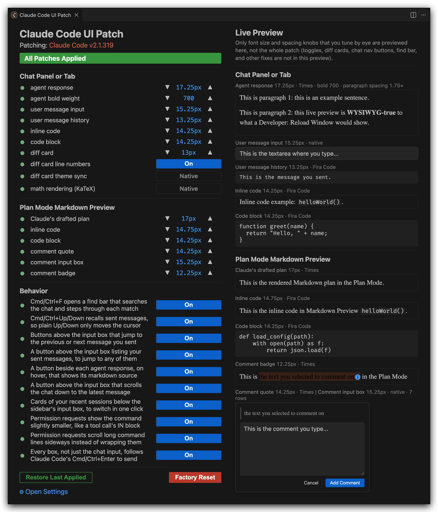
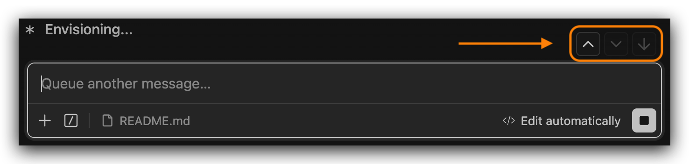
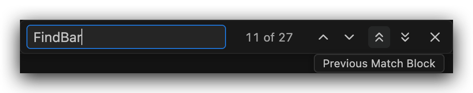
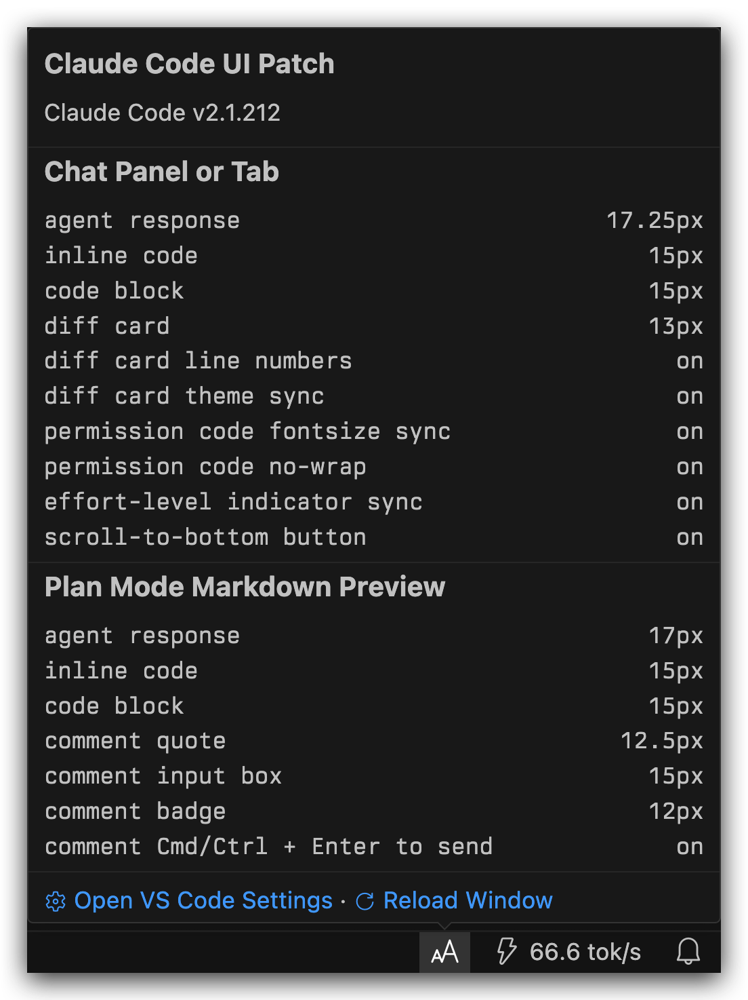
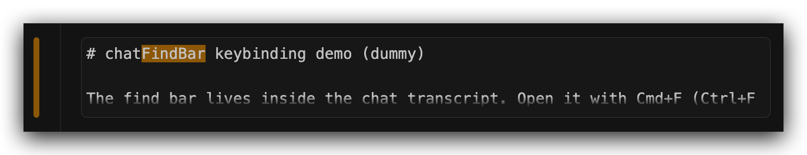

# Claude Code UI Patch

[](https://marketplace.visualstudio.com/items?itemName=zeyutang.claude-code-ui-patch)
[](https://marketplace.visualstudio.com/items?itemName=zeyutang.claude-code-ui-patch)
[](https://open-vsx.org/extension/zeyutang/claude-code-ui-patch)
[](https://open-vsx.org/extension/zeyutang/claude-code-ui-patch)

Patch Claude Code VS Code extension UI to provide finegrained settings for various UI details (font sizes, code blocks, diff cards, and more).

|               Configuration Panel + Live Preview                |
| :-------------------------------------------------------------: |
|  |

|      Previous and Next Turn, Scroll to Bottom      |
| :------------------------------------------------: |
|  |

|              Find Bar               |              Status Bar Icon               |
| :---------------------------------: | :----------------------------------------: |
|  |  |

|            Find Bar: Match and Match Block            |
| :---------------------------------------------------: |
|  |

## What This Extension Patches

Settings live under the `claudeCodeUiPatch.*` namespace (prefix omitted below) and each defaults to Claude Code's native value.
The tree shows every knob, what it targets, and what scales with what: an indented child follows its parent until you give it a value.
The one exception is the "Always applied" group at the end, which has no setting: it fills in what the native interface leaves out, so installing the patch is the opt-in and uninstalling it is the undo.

```text
chat.fontSize & chat.fontFamily        # native VS Code settings, shared by every chat extension
   │                                   # therefore, this patch does NOT override them
   ├── input box
   ├── interface chrome (buttons, headers, token counts)
   ├── user messages + attachment chips (text font: see chatInputHistoryFontFamily)
   └── other chat extensions (Codex, Copilot, ...)

Chat Panel and Tab                     # chat history only, private to Claude Code
   ├── chatHistoryFontSize             # agent message text, 0 -> follows chat.fontSize
   ├── chatHistoryFontFamily           # agent message font, empty -> native UI font
   ├── chatHistoryBoldWeight           # weight of bold text in agent messages, 0 -> native (700)
   ├── chatHistoryParagraphSpacing     # visible gap between agent paragraphs, 1.0 = native
   ├── chatInputHistoryFontSize        # sent user message text, 0 -> follows chat.fontSize
   ├── chatInputHistoryFontFamily      # sent user message font, empty -> native chat font
   ├── chatCodeBlockFontSize           # fenced code blocks, 0 -> native
   │      └── chatCodeInlineFontSize   # inline code, 0 -> follows chatCodeBlockFontSize
   ├── chatMathRendering               # TeX math via bundled KaTeX if On
   │                                   #   (Claude Code 2.1.301+ does this itself)
   ├── chatMathFontSizeEm              # math size in em of chat text, 1.0 = match, 0 -> native
   └── diff cards                      # Edit / MultiEdit tool cards + expand modal
          ├── chatDiffCardFontSize     # diff code size, 0 -> native
          ├── chatDiffCardLineNumbers  # true file line numbers (when known) if On
          └── chatDiffCardThemeSync    # follow VS Code light/dark theme if On
                                       #   (Claude Code 2.1.267+ does this itself)

Plan Mode Markdown Preview
   ├── planPreviewFontSize             # preview text (headings scale with it), 0 -> native
   ├── planPreviewFontFamily           # preview font, empty -> native
   ├── planPreviewCodeBlockFontSize    # fenced code blocks, 0 -> native
   │      └── planPreviewCodeInlineFontSize      # 0 -> follows planPreviewCodeBlockFontSize
   └── select-and-comment UI
          ├── planPreviewCommentInputFontSize    # comment box text, 0 -> native
          ├── planPreviewCommentInputRows        # comment box height in rows, 0 -> native
          ├── planPreviewCommentQuoteFontSize    # selected-text quote, 0 -> native
          └── planPreviewCommentBadgeFontSize    # comment badge, 0 -> native

Behavior
   ├── chatFindBar                     # working Cmd/Ctrl+F find bar in the chat, if On
   │      ├── chatFindBar{Next,Previous}MatchKeys       # extra match chords, comma-separated
   │      └── chatFindBar{Next,Previous}MatchBlockKeys  # block-skip chords atop Cmd/Ctrl+(Shift+)Enter
   ├── chatInputCtrlUpDownToHistory    # recall sent messages via Cmd/Ctrl+Up/Down only, if On
   │                                   #   (macOS: Cmd+Ctrl+A/E move to the input's start/end)
   ├── chatInputMaxLines               # input box: grow to N lines + keep bottom gap, 0 -> native
   ├── chatPopupInputMaxLines          # question "Other" + permission box: N lines, 0 -> native
   ├── chatJumpToMessageButtons        # prev/next above input/permission box: jump turns, if On
   ├── chatPromptHistoryButton         # button left of prev/next: pick a message to jump to, if On
   │                                   #   (compaction summaries, /compact, /model, /effort and
   │                                   #   text-less messages start folded)
   ├── chatRawMarkdownButton           # response hover button: show its markdown source, if On
   ├── chatScrollToBottomDot           # button above input/permission box: scroll to newest, if On
   │                                   #   also auto-scrolls on a permission/question box only when
   │                                   #   already at the bottom, then follows the box as it settles
   │                                   #   (either button On: a question box dims the history like a
   │                                   #   permission box, and an open find bar lifts the dim)
   ├── chatSessionCards                # sidebar: recent session cards below the input box, if On
   │                                   #   (unsent drafts first, with a still dot; breathes orange
   │                                   #   while working, background tasks included, amber with a
   │                                   #   breathing title when it needs you, green when a finished
   │                                   #   turn is unseen)
   ├── chatShowMoreAndLessAlign        # "left" / "right", empty "" -> native
   ├── chatPermissionCodeMatchChatCodeBlock  # permission cmd: IN block's .85em (On) or .9em (Off)
   ├── chatPermissionCodeNoWrap        # permission cmd: no-wrap + h-scroll (On) or wrap (Off)
   ├── effortSyncFix                   # push persisted effort level to a reloaded session if On
   ├── planPreviewCommentInputCtrlEnterToSend  # Cmd/Ctrl+Enter sends, plain Enter newlines if On
   └── useCtrlEnterToSendEverywhere    # native useCtrlEnterToSend reaches the question "Other" box,
                                       #   permission feedback box, and plan comment box if On

Always applied                         # no setting; installing this patch is the opt-in
   ├── permission focus ring           # focused permission/question box gets the input box's ring
   ├── question answer box reveal      # typing keeps the "Other" box's border and padding in view
   ├── wheel reversal                  # chat and lists: turning the wheel back at the end scrolls
   ├── editor scrollbars               # hides scrollbars as editor.scrollbar.* hides them
   ├── permission text selection       # permission/question box: select and copy its text
   ├── expanded prompt header          # "Show more" keeps the prompt on top in its own scroller
   ├── hidden cursor                   # macOS: a cursor hidden by typing hovers nothing until moved
   ├── session delete button           # session list rows: move a conversation to the Trash
   ├── untitled session stays          # opening the history keeps you on an Untitled session
   ├── editor selection colors         # selected text in the editor's selection colors
   ├── input box redraw                # selecting chat text no longer redraws the input box
   ├── diff card release               # a session you switch away from no longer stays in memory
   ├── session open landing            # an opened session shows its last lines at once, no jump
   ├── session view on return          # a session you go back to shows where you left it
   ├── inline math spans               # fix for math rendering
   ├── last turn delete                # prompt history: delete the last turn within 30s
   ├── compacted history               # a reopened session shows its turns from before compactions
   ├── bookmark notes                  # Bookmarks pane rows: annotate a bookmark with your own note
   ├── file link reveal                # a file link goes to the file's open tab in any group
   ├── shell here-documents            # shell code blocks: a here-document's body reads as text
   ├── sticky copy button              # a code block's copy button stays in view as it scrolls
   └── reload during a turn            # a reload while Claude is working reopens that session

Unified codeFontFamily                 # code font only; IN/OUT block, chrome, diff cards stay native
   ├── chat panel and tab  (fenced code + inline code)
   ├── plan mode preview   (fenced code + inline code)
   └── permission prompt   (command block)
```

## Using This UI Patch

### VS Code

Install from the **VS Code Marketplace**: [Claude Code UI Patch](https://marketplace.visualstudio.com/items?itemName=zeyutang.claude-code-ui-patch)

### VSCodium, Cursor, Windsurf, and other forks

Install from the **Open VSX Registry**: [Claude Code UI Patch](https://open-vsx.org/extension/zeyutang/claude-code-ui-patch)

### Get Claude Code patched

- **Panel controls:** Press `Cmd+Shift+P` / `Ctrl+Shift+P` (or `F1`) to open the Command Palette, then run **Claude Code UI Patch: Open Panel**. Or alternatively, click the `aA` item at the far right of the status bar.
  Use `▼`/`▲`, toggles an On/Off switch, and each row's sync dot shows green (in effect), yellow (restart needed), or red (unavailable on this Claude Code version).
  When changes are pending, the header banner turns amber and becomes the apply button, labelled with the lightest restart that will do: **Refresh Webviews** for chat changes (your Claude Code session stays up), **Restart Extensions** when a Plan Mode Preview change needs a fresh extension host, or **Reload Window** when neither is safe.
- **Direct edits:** Font families, the math size (`chatMathFontSizeEm`), the input-box line cap, comment-box rows, and the "Show more/less" button alignment have no panel control, set them in VS Code Settings via direct edits. `claudeCodeUiPatch.*` settings apply on the next restart the banner offers.

## Caveats

- **The patch reverts when Claude Code updates.**
  The next window reload re-applies it and prompts for one more restart, which right after an update is always **Reload Window**.
- **`chatDiffCardLineNumbers` shows true file positions for live-session edits only.**
  Cards replayed from history (reload, resume), failed edits, and `replace_all` edits number from 1 (Claude Code re-emits conversation history without the absolute line numbers).
- **`chatHistoryBoldWeight` applies to bold runs, not headings.**
  Headings keep their own size-based hierarchy.
  A font with no cut at the weight you pick falls back to its nearest one, so which step changes anything depends on the family: Charter, for instance, goes from 700 straight to its 900 Black.
- **`chatHistoryFontSize` / `chatHistoryFontFamily` restyle the agent transcript only** (by design).
  The input box, interface, and other chat extensions follow the native `chat.fontSize` / `chat.fontFamily`.
  Your own sent messages are styled by `chatInputHistoryFontSize` / `chatInputHistoryFontFamily`.
- **`chatMathRendering` bundles KaTeX into the chat webview** (MIT code, SIL OFL 1.1 fonts; licenses ship in `assets/katex/`) and removes it fully when the toggle turns off.
  Rendering covers the chat only, not the Plan Mode preview.
  Claude Code 2.1.301 and later render math themselves, and there it bundles nothing while `chatMathFontSizeEm` still sizes their math.
- **`chatRawMarkdownButton` reveals the source of agent responses only.**
  Thinking blocks, tool output, compact summaries, and slash-command results get no button.
  The button sits in the left gutter and shows while the pointer is anywhere at the response's height, staying within reach down a long response.
  Each response switches on its own, and all of them are back to rendered after a webview reload.
- **`chatFindBar` replaces native `Cmd`/`Ctrl`+`F` widget inside the chat webview** (tab and sidebar alike).
  The Match Case, Match Whole Word, and Use Regular Expression toggles in its input work as in the editor's find widget, with JavaScript regular expression syntax.
  Math in agent responses matches by its TeX source, as its raw markdown reads, so `\frac{a}{b}` finds that fraction while the symbols it renders do not match.
  A query lands on the first match from where you were reading when you began typing it, then wraps to the first in the conversation.
  Stepping to a match, or scrolling or clicking in the chat, moves that starting place.
  After a session switch the count reads `? of n` until you step to a match or change the query.
- **`chatSessionCards` shows local sessions in the sidebar chat only.**
  Sessions you left with an unsent message in the sidebar's input box come first, in the order you left them, then the rest from the session where you last sent a message or answered a permission or question prompt, not counting a model or effort change or a slash command.
  A new session gets its card once you send it a message or Claude starts working in it, or once you leave it with an unsent message in its input box.
- **A reopened conversation shows its turns from before each compaction.**
  Claude Code reopens a compacted conversation from its last summary, and this patch puts the earlier turns back, with a "Compacted chat" row at each compaction, as the chat showed them before the reload.
  The chat keeps its own limit of about 600 rows, so a very long conversation still drops its oldest tool calls first, and the longest drop their oldest turns.
  With `chatPromptHistoryButton` on, each compaction is an entry holding its summary, and these entries, `/compact`, `/model` and `/effort` echoes, and messages with no text, such as an attachment sent alone, start folded, while opening their fold keeps them in view for that conversation.
- **Last turn delete reaches the last turn only, within its first 30 seconds.**
  With `chatPromptHistoryButton` on, only the last prompt history entry's delete button works, and only until Claude uses a tool that can leave changes behind, such as editing a file, running a command, or starting a subagent.
  A first click turns it into "sure?", and a second stops the turn and removes it, its reply, and what it left in the conversation's transcript, as if the prompt had never been sent.
- **Bookmark notes are kept with Claude Code's own bookmarks.**
  A notepad button on each Bookmarks pane row adds a note of your own, which the row shows in place of the response's opening line.
  Without this patch Claude Code ignores the notes, and the next bookmark change in that conversation discards them.
